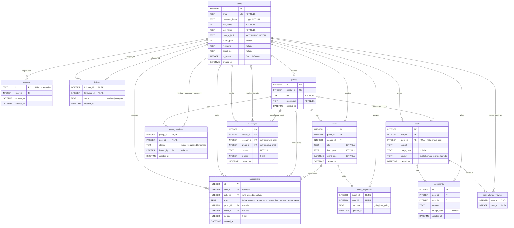

# Social Network: Database ERD

Nov 23, 2026. Agreed on day 1. Matches the migration numbers in the team plan. Commit this file as `docs/ERD.md` in the repo: GitHub renders the Mermaid diagram below.

## Diagram



How to read the lines: `||` means "exactly one", `|o` means "zero or one" (a nullable foreign key), `o{` means "zero or more". So `groups |o--o{ posts` says a post belongs to zero or one group, and a group has many posts.

## Tables, owners and constraints

Every table gets `created_at DATETIME DEFAULT CURRENT_TIMESTAMP` (UTC). Every foreign key uses `ON DELETE CASCADE` unless it says otherwise, so deleting a post also deletes its comments and allowed viewers.

| # | Table | Owner | Key constraints |
| --- | --- | --- | --- |
| 000001 | users | A | `email UNIQUE NOT NULL`. `is_private INTEGER NOT NULL DEFAULT 0 CHECK (is_private IN (0,1))`. The 5 required register fields are `NOT NULL`; `avatar_path`, `nickname`, `about_me` are nullable |
| 000002 | sessions | A | `id TEXT PRIMARY KEY` (UUID from gofrs/uuid or google/uuid). Index on `user_id` |
| 000003 | follows | A | `PRIMARY KEY (follower_id, following_id)`. `CHECK (follower_id <> following_id)`. `status CHECK (status IN ('pending','accepted'))`. Index on `(following_id, status)` for follower lists |
| 000004 | posts | B | `privacy CHECK (privacy IN ('public','almost_private','private'))`. `group_id` nullable. Indexes on `user_id` and `group_id` |
| 000005 | post_allowed_viewers | B | `PRIMARY KEY (post_id, user_id)`. Only used when `privacy = 'private'` |
| 000006 | comments | B | Index on `post_id` |
| 000007 | groups | C | `title` and `description NOT NULL` |
| 000008 | group_members | C | `PRIMARY KEY (group_id, user_id)`. `status CHECK (status IN ('invited','requested','member'))`. `invited_by` nullable, `ON DELETE SET NULL` |
| 000009 | events | C | `title`, `description`, `event_time NOT NULL`. Index on `group_id` |
| 000010 | event_responses | C | `PRIMARY KEY (event_id, user_id)`. `response CHECK (response IN ('going','not_going'))` |
| 000011 | messages | B | `CHECK ((receiver_id IS NULL) <> (group_id IS NULL))`: exactly one of the two is set. Indexes on `(sender_id, receiver_id)` and `group_id` |
| 000012 | notifications | A | `type CHECK (type IN ('follow_request','group_invite','group_join_request','group_event', 'follow_accepted','new_follower'))`. Index on `(user_id, is_read)` |
| 000013 | seed data | C | Bonus, week 3. Only `INSERT`s; its `.down.sql` deletes them |

## What each notification row points at

The notification stores enough IDs for the bell to show Accept / Decline and call the right endpoint.

| type | user_id (recipient) | actor_id | group_id | event_id | Accept / Decline calls |
| --- | --- | --- | --- | --- | --- |
| follow_request | the private user | the requester | | | follows: set `accepted` or delete the row |
| group_invite | the invitee | the member who invited | ✓ | | group_members: set `member` or delete the row |
| group_join_request | the group creator | the requester | ✓ | | group_members: set `member` or delete (creator only) |
| group_event | every member except the creator | the event creator | ✓ | ✓ | none, it links to the event |
| follow_accepted, new_follower (bonus) | the follower / followed user | the other user | | | none |

## Design decisions to explain at the audit

**Why `status` columns instead of separate request tables.** A follow request and a follow are the same relationship at two stages, so one `follows` row moves from `pending` to `accepted`. Declining deletes the row. The same idea covers group invites, join requests and membership in `group_members`. Fewer tables, fewer joins, and the composite primary key stops duplicate requests for free.

**Why composite primary keys** (`follows`, `post_allowed_viewers`, `group_members`, `event_responses`). The pair *is* the identity: a user can follow someone once, answer an event once. The database refuses a duplicate, so the Go code does not have to check first. For RSVP, use `INSERT ... ON CONFLICT(event_id, user_id) DO UPDATE SET response = excluded.response` so switching from Going to Not going is one query.

**Why posts has a nullable `group_id`.** Group posts and profile posts are the same thing with the same comments, so C reuses B's code. A group post ignores `privacy`; its visibility is "is the viewer a member?". `CanViewPost` checks `group_id` first.

**Why one `messages` table for both chats.** A private message has `receiver_id`, a group message has `group_id`, and the `CHECK` makes it impossible to have both or neither. `is_read` is only used for private messages (the unread badge).

**Why the creator is a row in `group_members`.** When C creates a group, the same transaction inserts the creator with `status = 'member'`. Then `IsMember()` is one query for everyone, and "only the creator approves join requests" is checked against `groups.creator_id`.

**Images.** Only the path (e.g. `uploads/3f2a….png`) is stored, never the file. The file is on disk with a UUID name, so a user cannot pick the filename and overwrite another file.

**Passwords and sessions.** `password_hash` holds the bcrypt hash, never the password. A session is a random UUID in the cookie mapped to `user_id` with an `expires_at`. Logout deletes the row, so a stolen old cookie stops working.

**Two SQLite details to know.**
- Foreign keys are **off by default** in SQLite. `sqlite.go` opens the DB with `?_foreign_keys=on` (mattn/go-sqlite3 DSN option), otherwise none of the `CASCADE` or `CHECK`-on-FK behaviour happens.
- `posts` (000004) references `groups`, which is created later (000007). SQLite allows this: it only checks a foreign key when a row is inserted, and by then every migration has run. If an auditor asks, that's the answer.

## Checking it at the audit

```bash
sqlite3 backend/data/social.db ".tables"
sqlite3 backend/data/social.db ".schema follows"
sqlite3 backend/data/social.db "SELECT version, dirty FROM schema_migrations;"
```

`schema_migrations` is created by golang-migrate and shows the last applied migration (13 when everything ran).
